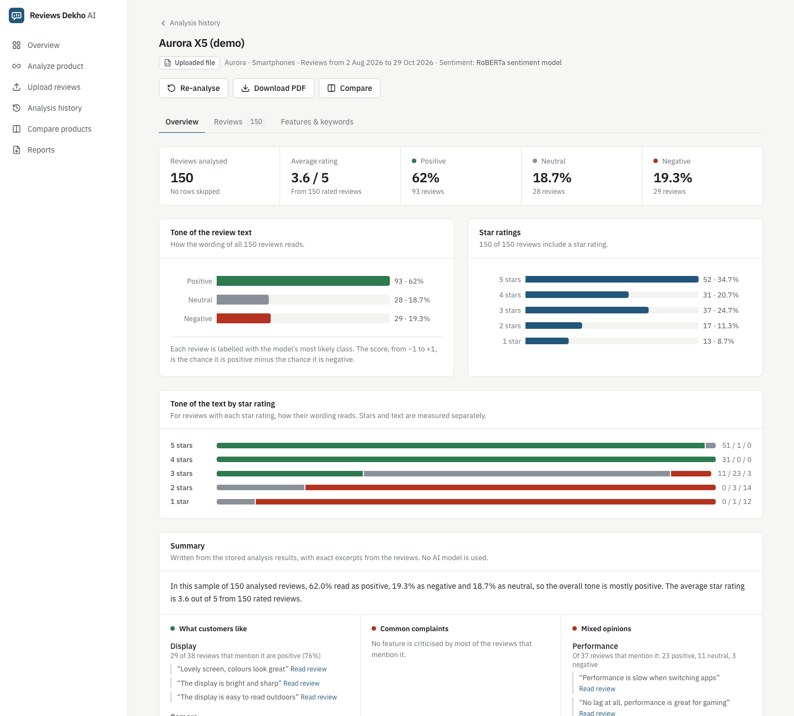
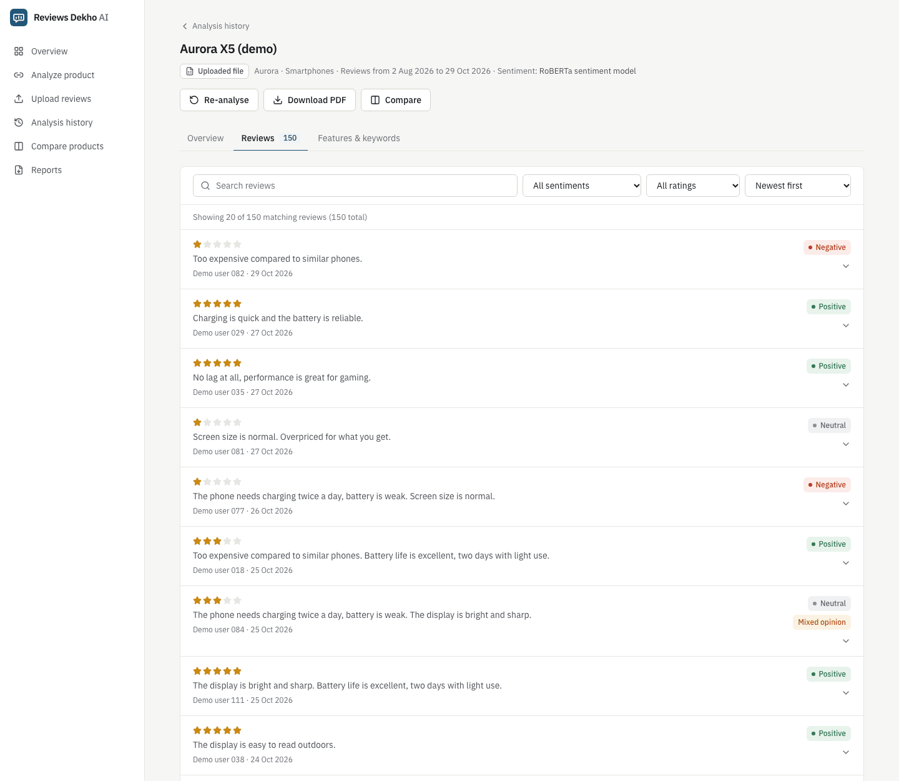
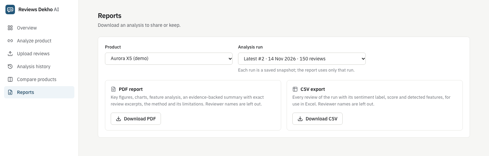
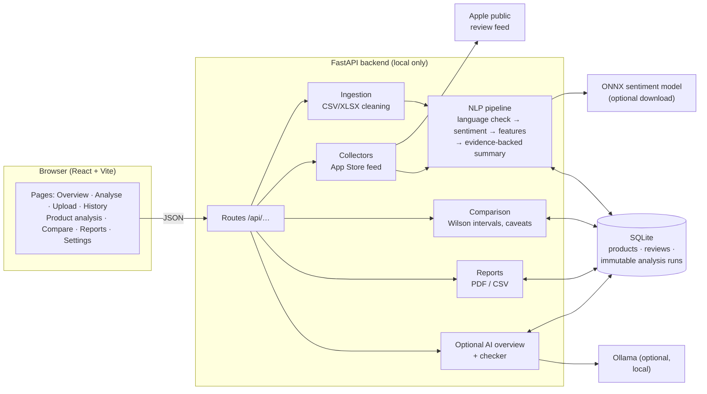

# Reviews Dekho AI

**Find out what customers think of a product from its reviews — with every number traceable to the reviews behind it.**

Upload reviews as a CSV or Excel file, or paste an Apple App Store link. Reviews Dekho AI works out the tone of each
review with a pretrained language model, finds which features people praise or complain about, compares star ratings
with what the text actually says, and writes an evidence-backed summary in which every claim shows its counts and exact
quotes. Any two saved analyses can be compared side by side, with sample-size caveats, and exported as PDF or CSV.
An optional overview can be written by a **local** language model (Ollama) and is checked against the evidence.

Everything runs on your own computer: no cloud AI, no paid API, no tracking.


<sub>All screenshots use the bundled **synthetic** demo data (invented products, reviews and reviewer names).</sub>

## Key features

| | |
|---|---|
| **Collect** | CSV / Excel upload with column detection, preview and cleaning · Apple App Store links (up to the 500 most recent reviews per country store, through Apple's public feed) · Amazon and Flipkart links are recognised but deliberately not scraped |
| **Analyse** | 3-class sentiment with a pretrained RoBERTa model (VADER fallback) · feature-level sentiment for physical products and apps · Hindi/Hinglish detection (excluded, not guessed) · star-rating vs text disagreements |
| **Explain** | Evidence-backed summary: each claim has exact counts and up to three verbatim excerpts with review IDs · searchable, filterable review list · nothing is generated by a language model unless you turn the optional AI on |
| **History** | Every analysis is an unchanging snapshot that records the engine used; re-analysing adds a new run |
| **Compare** | Two products, or two runs of one product, side by side with 95% intervals, "clear separation" only when the samples support it, and caveats for sample size, language, engine, source and period |
| **Report** | A4 PDF report and CSV export for any stored run; reviewer names are left out by default |
| **Optional AI** | A short overview by `llama3.2:3b` through Ollama, citing claim and excerpt IDs; a checker rejects detectable errors; off by default |

<table>
<tr>
<td width="50%"></td>
<td width="50%"></td>
</tr>
<tr>
<td></td>
<td><br><br>
</td>
</tr>
</table>

## Two-minute demo

Needs Python 3.12 or 3.14 and Node 24 (the versions verified; see [Tests](#tests-and-ci)).

```bash
# 1. Backend + synthetic demo data (a separate demo database; your real data is never touched)
cd backend
python3 -m venv .venv
.venv/bin/pip install -r requirements.txt
.venv/bin/python scripts/seed_demo.py --engine vader      # ~2 s; omit --engine vader if the model is installed
DATABASE_URL=sqlite:///storage/demo.db .venv/bin/uvicorn app.main:app --reload

# 2. Frontend (second terminal)
cd frontend
npm ci
npm run dev                                                # open http://localhost:5173
```

The demo has four products — two phones to compare (**Kestrel Orbit 5G** vs **Aurora X5**), an app with two analysis
runs before and after a (fictional) update (**QuickCart**: compare run #3 with #4), and earphones with Hinglish reviews
that are marked "not analysed" (**Saffron Buds**). No backend at all? The built-in demo product works in the browser on
its own.

`scripts/seed_demo.py` only writes a file whose name contains "demo", never the real database
(`storage/reviews_dekho.db`) or whatever `DATABASE_URL` points to, never inside the source tree (except the git-ignored
`backend/storage/`), and never over an existing file unless `--reset` is given **and** the file carries the script's own
marker. Each run prints a content digest of the stored results; the same files and engine always give the same digest
(checked on Python 3.12 and 3.14).

## Technology

| Layer | Stack |
|---|---|
| Backend | Python, FastAPI, SQLAlchemy 2 + SQLite (versioned migrations with automatic backups), pandas/openpyxl, httpx |
| NLP | `cardiffnlp/twitter-roberta-base-sentiment-latest` as int8 ONNX via `onnxruntime` + `tokenizers` (no PyTorch); VADER + review rules; keyword feature lists; scikit-learn for keywords and evaluation |
| Reports | ReportLab (vector charts, DejaVu Sans) |
| Optional AI | Ollama with `llama3.2:3b`, JSON-schema output, deterministic settings |
| Frontend | React 19, React Router 7, Vite 8, Tailwind CSS 4, Recharts, lucide icons; IBM Plex Sans bundled locally |
| Quality | pytest, Vitest + Testing Library, oxlint, axe-core audits, GitHub Actions |

## Architecture



An analysis run stores its statistics, feature table, keywords, summary, per-review results and the engine record as one
snapshot. Reports, comparisons and the AI overview all read these snapshots; nothing re-analyses old runs, so history
stays exactly as it was.

## Installation and configuration

```bash
cd backend
python3 -m venv .venv && .venv/bin/pip install -r requirements.txt
.venv/bin/python scripts/download_model.py   # optional, ~128 MB, SHA-256-checked (see below)
.venv/bin/uvicorn app.main:app --reload       # http://localhost:8000 · API docs at http://localhost:8000/docs

cd frontend && npm ci && npm run dev          # http://localhost:5173
```

| Setting (environment variable) | Default | Meaning |
|---|---|---|
| `DATABASE_URL` | `sqlite:///backend/storage/reviews_dekho.db` | Database file; older databases are upgraded on start after a backup to `backend/storage/backups/` |
| `SENTIMENT_ENGINE` | `auto` | `auto`: the model if installed, else VADER · `vader`: always VADER |
| `CORS_ORIGINS` | the Vite dev/preview addresses on localhost | Frontend origins allowed to call the API |
| `AI_SUMMARIES` | `off` | `on` enables the optional AI overview |
| `OLLAMA_URL` / `OLLAMA_MODEL` / `OLLAMA_TIMEOUT_SECONDS` | `http://127.0.0.1:11434` / `llama3.2:3b` / `120` | Local Ollama server, model and timeout |
| `VITE_API_URL` (frontend) | `http://localhost:8000/api` | Where the frontend finds the API, e.g. if port 8000 is taken |

**Sentiment model.** `scripts/download_model.py` downloads `onnx/model_quantized.onnx`, `tokenizer.json` and
`config.json` (≈ 128 MB) from [`Xenova/twitter-roberta-base-sentiment-latest`](https://huggingface.co/Xenova/twitter-roberta-base-sentiment-latest),
pinned to revision `f3ec4d0925f90c3ca7ee7814f52d6ee7cf180445`; each file must match its SHA-256 hash. If the model
isn't installed or fails during an analysis, the whole run uses VADER, so a run never mixes engines; every run records
which engine it used and why it fell back.

## API

Interactive documentation (Swagger) is at `/docs` while the backend runs. Every error is `{"detail": "<readable message>"}`.

| Area | Endpoints |
|---|---|
| Products | `GET/POST /api/products` · `GET/PATCH/DELETE /api/products/{id}` · `POST /api/products/from-url` · `POST /api/products/{id}/refresh` |
| Upload | `POST /api/uploads/preview` (detect columns) → `POST /api/uploads/import` (max 10 MB, 20,000 rows) |
| Analysis | `GET /api/products/{id}/analysis` · `POST /api/products/{id}/analyze` (new run) |
| Reviews | `GET /api/products/{id}/reviews` (search, filters, sorting, paging, `analysis_id`) · `GET …/reviews/{reviewId}` · `POST/DELETE …/reviews` |
| History | `GET /api/history` · `GET/DELETE /api/history/{analysisId}` |
| Compare | `GET /api/compare?product_a=&product_b=&analysis_a=&analysis_b=` |
| Reports | `GET /api/products/{id}/report.pdf` · `GET /api/products/{id}/report.csv` (`analysis_id`, `include_reviewer`) |
| Optional AI | `GET /api/ai/status` · `GET/POST /api/products/{id}/ai-summary` |
| Other | `GET /api/health` · `GET /api/sites` |

## How the analysis works, and how well

1. **Language check.** Only English is analysed. A word-list check marks Hindi, Hinglish (Hindi in Latin letters) and
   other scripts as **"Not analysed"**: they are left out of the sentiment and feature figures, but their star ratings
   still count.
2. **Sentiment.** Each review is labelled positive / neutral / negative by the RoBERTa model (or VADER).
3. **Features.** Reviews are split into clauses; a clause mentioning a feature keyword (battery, delivery… for products;
   login, crashes, ads… for apps) is scored on its own, so one review can praise one feature and criticise another.
4. **Summary.** Claims are built only from these counts, with up to three exact excerpts each — for the Aurora X5
   demo phone (RoBERTa model): "Display is mostly praised: 29 of the 38 analysed reviews that mention it read as positive (76%)." and "Opinions on Performance are divided: of the 37 analysed reviews that mention it, 23 read as positive, 11 as neutral and 3 as negative."

**Evaluation** ([`docs/EVALUATION.md`](docs/EVALUATION.md), generated by `backend/scripts/evaluate_sentiment.py`; the
public datasets are downloaded pinned to exact files and SHA-256-checked; only numbers are committed):

| Test | Data (human labels) | RoBERTa model | VADER + rules |
|---|---|---|---|
| E1 sentence sentiment | UCI Sentiment Labelled Sentences, 3,000 Amazon / Yelp / IMDb sentences | **85.9%** accuracy | 69.5% |
| E2 feature sentiment | SemEval-2014 Task 4 test sets, per aspect term, clause context | **76.8%** laptops (638) · **78.9%** restaurants (1,120) | 63.5% laptops |
| E3 language check | SentiMix Hindi-English **untouched test split** | flags **87.7%** of Hindi-dominant tweets, **0.0%** of 3,000 English review sentences | — |
| E4 agreement with stars | 1,942 live App Store reviews (stars are weak labels, **not** accuracy) | 73.8% agreement | 65.3% |

E1's gold labels are binary, so any "neutral" answer counts as wrong; the full methodology, confusion matrices and the
development/test separation are in the evaluation document.

## Comparison methodology

A comparison is computed on request from two stored runs (nothing is re-analysed or stored). Shares use the number of
**analysed** reviews (or a feature's mentions) as their base and are shown with their counts and a **95% Wilson
interval**. A difference is described as **"clear separation in these samples"** only when both bases are at least 30
and the intervals don't overlap; otherwise it is "intervals overlap", "too few to compare" or "not measurable". This
describes the two samples — it is **not** a significance test: reviews are self-selected, not a random or
representative sample of customers. Features are compared by mention share and tone, never raw counts; a feature that
wasn't looked for on one side (e.g. an app and a phone) is "not looked for", never a zero. Caveats appear above the
results for samples under 30, a 5× size gap, more than 10% not analysed, different engines, domains, sources or review
periods, and same-product runs (which share most of their reviews). There is no overall winner.

## Optional AI overview (local, off by default)

```bash
ollama pull llama3.2:3b     # ~2.0 GB, once
ollama serve                # in another terminal
AI_SUMMARIES=on .venv/bin/uvicorn app.main:app --reload
```

The model receives only a structured evidence package (claims with IDs, their exact excerpts and the overall figures —
no full reviews, no reviewer names) and must answer in JSON (temperature 0, seed 42), citing claim and excerpt IDs for
every sentence. A checker rejects sentences that cite unknown evidence, use numbers not in the cited claims, quote text
that isn't verbatim, mention uncited features, contradict a claim's direction, call a tone "mostly X" without a
majority, or generalise to "all customers"; the model gets one retry. The overview is shown **below** the
evidence-backed summary, labelled with the model, and never replaces it; PDFs never include it. Starting the backend
without `AI_SUMMARIES=on` hides it completely.

**Measured** ([`docs/evaluation/ai_overview/`](docs/evaluation/ai_overview/)) on an Apple M3 with 8 GB RAM, Ollama
0.16.3, `llama3.2:3b` (digest `a80c4f17acd5…`, about 2.8 GB in memory while loaded):

| Run | Cases | Accepted | Manual check of accepted sentences |
|---|---|---|---|
| Phase 6 final round (historical) | 8 synthetic, the synthetic sample, 2 real App Store apps | **8 of 10** (1 case refused by design: too few reviews) | 24 sentences: **20 fully supported, 4 partially, 0 unsupported** (reviewed by the AI coding assistant against the cited evidence; not independently re-checked) |
| Phase 8 run, version-controlled harness | the 9 synthetic cases | **7 of 8** | not done yet — labels are left empty rather than guessed |

One overview took 6–53 s. **The checker is not a guarantee of factual accuracy**: it catches checkable errors, but a
sentence can pass and still mislead — the partially supported sentences above had correct numbers but described the
wrong population or quoted an excerpt that didn't fit the wording. Re-run with
`cd backend && .venv/bin/python scripts/evaluate_ai_overview.py` (synthetic cases only; reports clearly and writes
nothing if Ollama isn't running). Later runs aren't expected to reproduce Phase 6 exactly: the overview wording changed
in between, and the cases with unchanged input did produce byte-identical answers.

## Reports

**Download PDF** / **Download CSV** on the analysis and Reports pages (or `GET /api/products/{id}/report.pdf|csv`)
build a file from one stored run — the latest by default, or any earlier run (`analysis_id`). The A4 PDF has the key
figures, vector charts, tone by star rating, the evidence-backed summary with excerpts and review IDs, the feature
table, the method with model attribution and the limitations — never the full review list and **no reviewer names**.
The CSV lists every review of the run with its sentiment and features; reviewer names only with `include_reviewer=true`.

## Security and privacy

* **Local only.** The backend has **no authentication or rate limiting** and must not be exposed to the internet. It
  listens on `127.0.0.1` by default and accepts browser requests only from the configured local origins (CORS).
* Uploads are limited to 10 MB and 20,000 rows, and reviews longer than 5,000 characters are shortened; CSV exports are protected against
  spreadsheet formula injection; PDF text is escaped.
* The only outbound requests are to Apple's public review feed (fixed URLs built from the app ID, with a generic
  User-Agent and no personal details) and, if enabled, to your local Ollama. Pages load no third-party resources (the
  font is bundled); this was checked in a browser on every route.
* Collected reviews and reviewer names are stored only in your local SQLite database. Reports and CSV exports leave
  reviewer names out by default.
* No secrets are needed or stored. Databases, model files and evaluation data are git-ignored.

## Deployment

* **Backend:** local use only (see above). A public deployment would need authentication, rate limiting, background
  jobs for large analyses and a server database; none of that is included.
* **Static demo:** `cd frontend && npm run build:demo` produces `dist-demo/`, a static, demo-only site (relative paths
  and `#/` addresses, so it works from any folder such as GitHub Pages). It never contacts any server — not even
  localhost — shows only the built-in synthetic demo product, and explains that uploads, collection, history,
  comparisons and reports need the local app. It hasn't been deployed.

## Tests and CI

```bash
cd backend && .venv/bin/python -m pytest       # 406 tests
cd frontend && npm test && npm run lint && npm run build && npm run build:demo   # 130 tests
```

Verified results (macOS, Apple M3):

| Configuration | Backend | Frontend |
|---|---|---|
| Development setup (Python 3.14.3, sentiment model installed, Ollama not running) | **405 passed, 1 skipped** (the live Ollama test); with Ollama running, the live test passed too | **130 passed**, oxlint clean, build and static-demo build OK |
| Fresh copy, new virtualenv, no model (Python **3.12.16** and **3.14.3**, Node 24.13) | **395 passed, 11 skipped** each (10 model tests, 1 live Ollama test) | 130 passed after `npm ci` |

Skipped tests are not run. Other checks: axe-core 4.10 on 16 routes at 375, 768 and 1440 px — **0 violations**, no
horizontal overflow, a visible focus ring on every Tab stop, and no third-party requests (also 0 violations for the
static demo build); mutation checks on the comparison thresholds, the AI checker and the demo-seed safety rules.
Accessibility was checked automatically and with the keyboard only — not yet with a screen reader or by users.

**CI** (`.github/workflows/ci.yml`, runs after a push): backend tests on Python 3.12 and 3.14 with VADER (no model
download, no Ollama), the demo seed's repeatability, the synthetic files' reproducibility, and frontend tests, lint,
build and static-demo build on Node 24. It has been checked locally but hasn't run on GitHub yet.

## Limitations

* **English only**; Hinglish is detected and excluded, not analysed. Detection is a heuristic, so some non-English text
  gets through.
* **Accuracy** was measured on product/restaurant reviews and tweets, not on human-labelled app reviews; sarcasm is
  misread. Reviews longer than 256 tokens are judged on their first 256 for overall tone.
* **Features are keyword-based**: other wordings are missed, and a keyword can pull in an unrelated clause (the
  evidence makes this visible).
* **App Store**: only the most recent 500 reviews per country store, and the feed changes over time.
* **Large uploads** are analysed inside one request: about 190 texts per second with the model on an Apple M3 (8 GB),
  so 20,000 reviews take roughly 3–4 minutes; the page shows an estimate above 5,000 reviews.
* **Comparison** "clear separation" is descriptive, not a significance test; with many features some separations
  appear by chance.
* **Optional AI** answers can be accepted and still be partly wrong; only `llama3.2:3b` was evaluated.
* PDFs can't draw Devanagari, CJK or many emoji (shown as □ with a note).

## Project layout

```
backend/app/       api/ (routes) · services/ (ingestion, analysis, collection, comparison, reports, AI) ·
                   nlp/ (engines, rules, language, aspects, summary) · collectors/ · reports/ (PDF) · migrations.py
backend/scripts/   seed_demo.py · make_demo_data.py · evaluate_sentiment.py · evaluate_ai_overview.py ·
                   download_model.py · demo snapshot and fixture builders
backend/data/      sample/ and demo/ (synthetic reviews)
frontend/src/      pages/ · components/ · lib/ (API client, formatting, filters) · demo/ (in-browser demo product)
docs/              PLAN.md (engineering log) · EVALUATION.md · evaluation/ (results) · screenshots/ · DESIGN_SYSTEM.md
```

[`docs/PLAN.md`](docs/PLAN.md) is the detailed engineering log: design decisions, every phase's verification and the
bugs found along the way.

## Licences and attribution

* **This project's code:** [MIT](LICENSE). Third-party files keep their own licences (listed in [`LICENSE`](LICENSE)).
* **Sentiment model**: `cardiffnlp/twitter-roberta-base-sentiment-latest` by Cardiff NLP, licensed
  [CC BY 4.0](https://creativecommons.org/licenses/by/4.0/). The ONNX file used here is a quantized conversion published
  by Xenova (`Xenova/twitter-roberta-base-sentiment-latest`, which names the Cardiff model as its base and states no
  separate licence); it is treated as a CC BY 4.0 adaptation of the original. It is downloaded by the user, not
  committed. Please cite:
  * D. Loureiro, F. Barbieri, L. Neves, L. Espinosa Anke, J. Camacho-Collados. *TimeLMs: Diachronic Language Models from
    Twitter.* ACL 2022 (System Demonstrations).
  * J. Camacho-Collados et al. *TweetNLP: Cutting-Edge Natural Language Processing for Social Media.* EMNLP 2022
    (System Demonstrations).
* **VADER**: C.J. Hutto and E. Gilbert, *VADER: A Parsimonious Rule-based Model for Sentiment Analysis of Social Media
  Text*, ICWSM 2014 (`vaderSentiment`, MIT licence).
* **Evaluation data** (downloaded by the scripts, never committed):
  [UCI Sentiment Labelled Sentences](https://archive.ics.uci.edu/dataset/331/sentiment+labelled+sentences)
  (Kotzias et al., KDD 2015; CC BY 4.0) · SemEval-2014 Task 4 aspect-based sentiment test sets (Pontiki et al., 2014;
  research use) · SentiMix Hindi-English, SemEval-2020 Task 9 (Patwa et al., 2020; Hugging Face mirror `RTT1/SentiMix`,
  listed as OpenRAIL). The Hinglish and English word lists in `backend/app/nlp/data/` are derived from the SentiMix
  training split.
* **Fonts**: [DejaVu Sans](https://dejavu-fonts.github.io/) 2.37 for PDFs (Bitstream Vera licence, DejaVu changes in
  the public domain; `backend/app/reports/fonts/LICENSE`) · [IBM Plex Sans](https://github.com/IBM/plex) 1.1.0 for the
  interface, © IBM, SIL Open Font License 1.1 (`frontend/src/assets/fonts/LICENSE-IBM-Plex-Sans.txt`).
* **Optional AI overview**: [Llama 3.2](https://www.llama.com/) 3B through [Ollama](https://ollama.com/), if you install
  it yourself; the model is subject to Meta's Llama 3.2 Community License. It is not bundled with this project.
* **App Store data**: reviews are read from Apple's public customer-review feed and stored only in your local database.
* **Demo data**: every product, review and reviewer name in `backend/data/sample/` and `backend/data/demo/` is invented.
