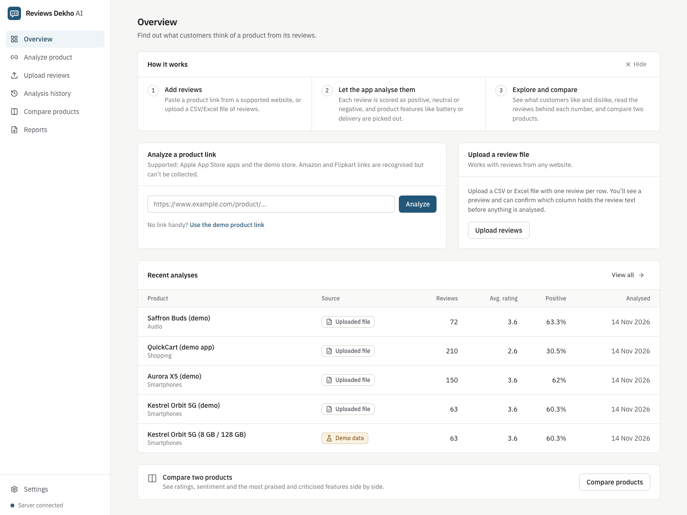
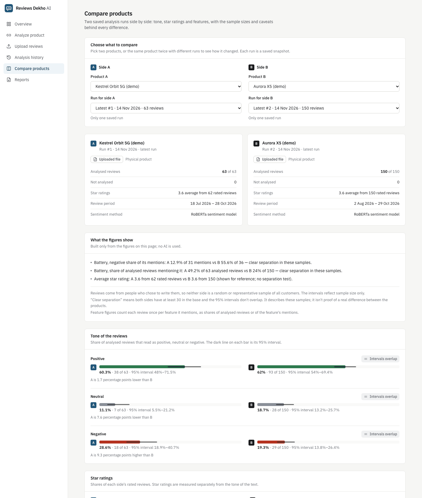
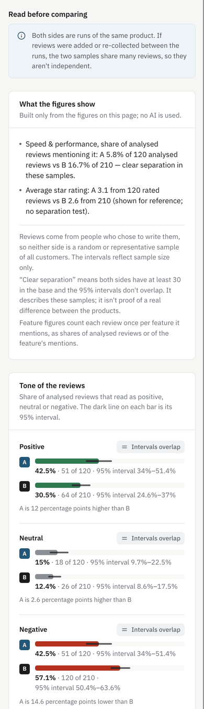
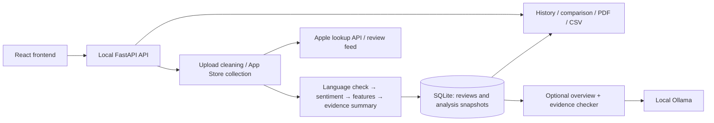

# Reviews Dekho AI

Turn product and app reviews into sentiment charts, feature-level insights and summaries backed by counts and exact
review excerpts. The full application runs locally, keeps analysis snapshots in SQLite, and supports comparisons
and PDF/CSV exports without a paid AI API.

**[Open the live demo](https://rrayyann7811.github.io/reviews-dekho-ai/)** ·
[Local setup](#local-setup) · [Architecture](#architecture) · [Evaluation](docs/EVALUATION.md)

## Live demo and full application

The GitHub Pages site is a **static, synthetic-data demo with no backend**. It shows one built-in product,
**Kestrel Orbit 5G**, with invented reviews and reviewer names. Explore its dashboard, review filters and feature
analysis; collection and upload controls are disabled. Saved analysis history, comparisons, exports and optional
Ollama overviews require the full application running on your computer. The demo makes no backend requests,
including to localhost.

| Capability | GitHub Pages demo | Full local application |
|---|---|---|
| Dashboard, review explorer, feature analysis | Built-in synthetic product | Imported or collected reviews |
| CSV/XLSX upload and App Store collection | Disabled | Available |
| Saved runs, comparisons, PDF/CSV exports | Unavailable | Available |
| Optional Ollama overview | Unavailable | Opt-in, local model required |



All screenshots show the full local application using bundled **synthetic** data; they do not imply that backend
features work on GitHub Pages.

<details>
<summary>More screenshots: analysis, review explorer, comparisons and reports</summary>

<table>
<tr>
<td width="50%"></td>
<td width="50%"></td>
</tr>
<tr>
<td></td>
<td><br><br>
</td>
</tr>
</table>
</details>

## Core features

- **Import and collect:** preview CSV/XLSX files, confirm column mappings, remove empty/duplicate reviews and inspect
  cleaning results. Collect recent written reviews from Apple App Store app links.
- **Analyse:** positive/neutral/negative sentiment using a pretrained RoBERTa model, with a VADER fallback;
  clause-level sentiment for keyword-matched product/app features; star-rating/text disagreement flags.
- **Explain and inspect:** summaries built from counts and up to three exact excerpts per feature claim, with review
  IDs; searchable, filterable and paginated review exploration. The standard summary does not use an LLM.
- **Keep history:** each analysis stores its inputs/results and engine metadata as a snapshot. Re-analysis creates a
  new run; reports and comparisons can use earlier runs without recomputing them.
- **Compare:** two products or two runs of one product, with 95% Wilson intervals and sample/source caveats.
  “Clear separation in these samples” requires at least 30 observations per side and non-overlapping intervals.
  This is descriptive, not a significance test or a product ranking.
- **Export:** A4 PDF reports with charts, evidence and method notes; CSV exports of a stored run's reviews and results.
  PDFs omit reviewer names; CSV includes them only through an explicit API option.
- **Optional AI overview:** a separate Ollama-generated overview with evidence references and validation checks.
  Off by default; it does not replace the standard summary and is not included in PDFs.

## Review sources and limits

| Source | Support in the full application |
|---|---|
| CSV / Excel (`.xlsx`) | Review exports from any source you are authorised to use; one product per upload. Preview and column mapping are available. Older `.xls` files must be converted. |
| Apple App Store | App metadata and up to 500 recent written reviews per country storefront, through Apple's lookup API and public review feed. Availability and review coverage can change. |
| Amazon / Flipkart | Links are recognised, but reviews are **not collected or scraped**. Use an authorised CSV/XLSX export instead. |
| Fictional demo store | One built-in synthetic product, opened in the frontend without collection. |

Uploads are limited to **10 MB and 20,000 rows**; review text is shortened to 5,000 characters. Only English is
analysed. Reviews flagged as Hindi, Hinglish or another unsupported language are excluded from sentiment/feature
figures, while their star ratings still count. Language detection is heuristic.

## Technology stack

| Layer | Implementation |
|---|---|
| Interface | React 19, React Router 7, Vite 8, Tailwind CSS 4, Recharts, Lucide; bundled IBM Plex Sans |
| API and storage | Python, FastAPI, SQLAlchemy, SQLite; versioned migrations with automatic backups |
| Ingestion and collection | pandas, openpyxl, httpx |
| NLP | Cardiff NLP Twitter-RoBERTa sentiment model via Xenova's int8 ONNX conversion, ONNX Runtime, tokenizers; VADER with review rules; keyword feature lists and scikit-learn keyword extraction |
| Reports / optional AI | ReportLab with DejaVu Sans / local Ollama (`llama3.2:3b` by default) |
| Quality | pytest, Vitest, Testing Library, oxlint, GitHub Actions; browser audits with axe-core |

## Architecture

The full application uses a React frontend and a local FastAPI API. The static demo is a separate Vite build mode
that reads bundled data and removes the backend API address.



Each stored run contains per-review results, statistics, features, keywords, summary evidence and engine metadata.
If the sentiment model fails, the pipeline reruns with VADER so a run never mixes engines. See the
[engineering log](docs/PLAN.md) for design decisions, migrations and comparison methodology.

## Local setup

Prerequisites: **Python 3.12 or 3.14**, **Node.js 24** and npm (the versions covered by CI). Commands below use a
macOS/Linux shell. Start each terminal from the repository root; no API keys or Ollama installation are required
for the standard application.

**Terminal 1 — backend**

```bash
cd backend
python3 -m venv .venv
.venv/bin/python -m pip install -r requirements.txt
.venv/bin/uvicorn app.main:app --reload
```

API: <http://localhost:8000> · Interactive API docs: <http://localhost:8000/docs>.
The database is created automatically at `backend/storage/reviews_dekho.db`.
Without downloaded sentiment model files, analysis uses VADER.

**Terminal 2 — frontend**

```bash
cd frontend
npm ci
npm run dev
```

Open <http://localhost:5173>. To try an upload, use the invented reviews in
[`backend/data/sample/`](backend/data/sample/) or [`backend/data/demo/`](backend/data/demo/).

### Optional: seed a separate synthetic demo database

From the repository root, after installing backend dependencies, run:

```bash
cd backend
.venv/bin/python scripts/seed_demo.py --engine vader
DATABASE_URL=sqlite:///storage/demo.db .venv/bin/uvicorn app.main:app --reload
```

Stop any backend already using port 8000 before starting this one. The seed creates four fictional products:
Kestrel Orbit 5G, Aurora X5, QuickCart (two saved runs) and Saffron Buds (mixed-language reviews).
It uses `storage/demo.db`, protects the real database, and refuses an existing file unless `--reset` is supplied
and the file carries the script's own demo marker. Use `--db storage/another-demo.db` for a new demo file.
The printed content digest can be compared between runs using the same files and engine.

### Optional: sentiment model and Ollama

For transformer sentiment, run from `backend/` and restart the backend afterwards:

```bash
.venv/bin/python scripts/download_model.py
```

This downloads approximately 128 MB from
[`Xenova/twitter-roberta-base-sentiment-latest`](https://huggingface.co/Xenova/twitter-roberta-base-sentiment-latest),
pinned to revision `f3ec4d0925f90c3ca7ee7814f52d6ee7cf180445` with SHA-256 checks. It is an ONNX conversion of
`cardiffnlp/twitter-roberta-base-sentiment-latest`; no PyTorch is needed.

For the optional overview, install Ollama separately, run `ollama serve` if it is not already running, then:

```bash
ollama pull llama3.2:3b
# From backend/, replace the running backend with:
AI_SUMMARIES=on .venv/bin/uvicorn app.main:app --reload
```

The local model receives product context, summary claims, aggregate figures and selected exact excerpts with IDs,
not the full review list or reviewer-name fields. JSON output is checked for unknown evidence, incorrect numbers,
non-verbatim quotes and other detectable errors, with one retry. **Passing the checker does not guarantee factual
accuracy.** Evaluation records and their manual-review caveats are in
[`docs/evaluation/ai_overview/`](docs/evaluation/ai_overview/).

### Configuration

Set backend environment variables before startup. Set `VITE_API_URL` in the frontend environment or a local
`frontend/.env` file before starting Vite or building; see [`.env.example`](frontend/.env.example).

| Variable | Default / purpose |
|---|---|
| `DATABASE_URL` | SQLite file at `backend/storage/reviews_dekho.db` by default; existing schemas require an explicit upgrade with backups. See [database migration instructions](docs/POSTGRESQL_MIGRATION.md) for SQLite and the local PostgreSQL foundation. |
| `SENTIMENT_ENGINE` | `auto`: use installed model, otherwise VADER. Set `vader` to force rule-based analysis. |
| `MODEL_DIR` | `backend/models/twitter-roberta-sentiment` |
| `CORS_ORIGINS` | Localhost/127.0.0.1 Vite dev and preview origins (ports 5173 and 4173), comma-separated |
| `AI_SUMMARIES` | `off`; set `on` to enable Ollama overviews |
| `OLLAMA_URL` / `OLLAMA_MODEL` / `OLLAMA_TIMEOUT_SECONDS` | `http://127.0.0.1:11434` / `llama3.2:3b` / `120` |
| `VITE_API_URL` | `http://localhost:8000/api`; ignored by the static-demo build |

## Testing and reproducibility

From the repository root, run each block separately:

```bash
cd backend
.venv/bin/python -m pytest -rs
# Focused checks for demo-seed safety, repeatable digests and synthetic file generation:
.venv/bin/python -m pytest tests/test_demo_seed.py
```

```bash
cd frontend
npm test
npm run lint
npm run build
npm run check:app-bundle
npm run build:demo
npm run check:demo-bundle
```

At the deployed application commit, frontend tests passed **144/144**. Backend tests passed **405 with 1 skipped**
locally with the sentiment model installed; CI on Python 3.12 and 3.14 passed **395 with 11 skipped** each (10 model
tests and the live Ollama test). See the [successful CI run](https://github.com/rrayyann7811/reviews-dekho-ai/actions/runs/43638988719).
Skipped tests do not establish model or Ollama correctness.

[CI](.github/workflows/ci.yml) runs on main pushes and pull requests: backend tests, demo digest/file reproducibility,
and frontend tests, lint, builds and bundle checks, including a demo build with a configured API address.
The live demo was audited on 11 routes at 375, 768 and 1440 px, including refreshes and keyboard interactions, with
no axe violations or horizontal overflow. This is not a screen-reader or user accessibility study.

Measured sentiment results, dataset definitions and limitations are in [the evaluation report](docs/EVALUATION.md)
and [raw results](docs/evaluation/results.json). To regenerate them, run
`.venv/bin/python scripts/evaluate_sentiment.py` from `backend/` (downloads pinned, checksum-checked evaluation
files and overwrites those result documents; the downloaded sentiment model is required). `--app-store` additionally
collects live reviews; agreement with stars is a weak-label measure, not model accuracy. Optional overview evaluation
uses `.venv/bin/python scripts/evaluate_ai_overview.py` from `backend/`; it requires Ollama with the configured model
and uses synthetic cases, writing results under git-ignored `storage/ai_eval/` by default.

## Privacy and data handling

- Reviews, reviewer names and analysis snapshots are stored in local SQLite. Database migrations create local backups;
  protect these alongside your database. Browser preferences use local storage.
- The application includes no analytics or tracking code and uses no cloud AI API. Runtime collection requests go to
  Apple's metadata/review endpoints; optional overview requests go to your configured Ollama server. Dependency,
  model and evaluation-data downloads require network access during setup/evaluation.
- Reviewer-name fields are omitted from PDFs and from CSV by default (`include_reviewer=true` opts in through the API).
  Review text and quoted excerpts can still contain personal information; inspect exports before sharing them.
- CSV cells are protected against spreadsheet formula injection and PDF text is escaped. Database files, model weights,
  downloaded evaluation data and `.env` files are git-ignored. No API keys are required.
- Default local mode is restricted to loopback clients and has no account sign-in. An optional JWT/ownership
  boundary is implemented for local testing; public hosting remains blocked by rate limiting, upload hardening and
  other safeguards. CORS is not access control. See [Phase 2A security preparation](docs/PHASE2A_SECURITY.md).

## Static-demo build and deployment

`npm run build:demo` (from `frontend/`) produces `frontend/dist-demo/` with relative assets and hash routes.
The [manual Pages workflow](.github/workflows/pages.yml) tests and builds that directory, checks the bundle, and
publishes only the static frontend. Pushing a commit does not trigger Pages deployment. The backend is never deployed.

The [current verified deployment](https://github.com/rrayyann7811/reviews-dekho-ai/actions/runs/43639442263)
uses application commit `53ae651bf123a75f91ae9e726d5ae96550029fc2`.

## Limitations and possible improvements

- English-only analysis with heuristic language detection; sarcasm and domain shifts can mislead sentiment models.
  Transformer inputs are truncated to 256 tokens. See the evaluation report for what was actually measured.
- Features rely on keyword lists and can miss paraphrases or match unrelated clauses. Exact evidence helps inspection,
  but does not make a sentiment label or summary claim ground truth.
- App Store feeds cover a recent, country-specific sample. Reviews are self-selected; comparisons are descriptive,
  and testing many features can produce apparent separations by chance.
- Large imports run synchronously in one request; there is no background job queue or multi-user access control.
- Optional AI may pass validation and still mislead. PDF fonts do not cover Devanagari, CJK or many emoji; missing
  glyphs are replaced with a marker and a note.

Potential future work, **not implemented**: background analysis jobs and progress reporting, independently reviewed
app-domain evaluation, better multilingual support, screen-reader/user testing, and authentication/rate limiting
before considering any public backend deployment.

## Technical reference

- [Engineering log and design decisions](docs/PLAN.md)
- [UI design system](docs/DESIGN_SYSTEM.md)
- [Sentiment evaluation and methodology](docs/EVALUATION.md)
- [Optional overview evaluation records](docs/evaluation/ai_overview/)
- [Backend API routes](backend/app/api/) and interactive Swagger docs at `/docs` when the backend runs

```text
backend/app/      api/ · services/ · nlp/ · collectors/ · reports/ · migrations.py
backend/scripts/  seed_demo.py · make_demo_data.py · download_model.py · evaluation scripts
backend/data/     sample/ and demo/ (synthetic reviews)
frontend/src/     pages/ · components/ · lib/ · demo/ (built-in product)
docs/             engineering log · evaluation results · screenshots · design system
```

<details>
<summary>API endpoint reference</summary>

Interactive documentation is at `/docs` while the backend runs. Error responses include a readable `detail` string.

| Area | Endpoints |
|---|---|
| Products | `GET/POST /api/products` · `GET/PATCH/DELETE /api/products/{id}` · `POST /api/products/from-url` · `POST /api/products/{id}/refresh` |
| Upload | `POST /api/uploads/preview` (detect columns) → `POST /api/uploads/import` (max 10 MB, 20,000 rows) |
| Analysis | `GET /api/products/{id}/analysis` · `POST /api/products/{id}/analyze` (new run) |
| Reviews | `GET /api/products/{id}/reviews` (search, filters, sorting, paging, `analysis_id`) · `GET …/reviews/{reviewId}` · `POST/DELETE …/reviews` |
| History | `GET /api/history` · `GET/DELETE /api/history/{analysisId}` |
| Compare | `GET /api/compare?product_a=&product_b=&analysis_a=&analysis_b=` |
| Reports | `GET /api/products/{id}/report.pdf` · `GET /api/products/{id}/report.csv` (`analysis_id`, `include_reviewer`) |
| Optional AI | `GET /api/ai/status` · `GET/POST /api/products/{id}/ai-summary` |
| Other | `GET /api/health` · `GET /api/sites` |

</details>

## Licences and attribution

* **This project's code:** [MIT](LICENSE). Third-party files keep their own licences (listed in [`LICENSE`](LICENSE)).
* **Sentiment model**: `cardiffnlp/twitter-roberta-base-sentiment-latest` by Cardiff NLP, licensed
  [CC BY 4.0](https://creativecommons.org/licenses/by/4.0/). The ONNX file used here is a quantized conversion published
  by Xenova (`Xenova/twitter-roberta-base-sentiment-latest`, which names the Cardiff model as its base and states no
  separate licence); it is treated as a CC BY 4.0 adaptation of the original. It is downloaded by the user, not
  committed. Please cite:
  * D. Loureiro, F. Barbieri, L. Neves, L. Espinosa Anke, J. Camacho-Collados. *TimeLMs: Diachronic Language Models from
    Twitter.* ACL 2022 (System Demonstrations).
  * J. Camacho-Collados et al. *TweetNLP: Cutting-Edge Natural Language Processing for Social Media.* EMNLP 2022
    (System Demonstrations).
* **VADER**: C.J. Hutto and E. Gilbert, *VADER: A Parsimonious Rule-based Model for Sentiment Analysis of Social Media
  Text*, ICWSM 2014 (`vaderSentiment`, MIT licence).
* **Evaluation data** (downloaded by the scripts, never committed):
  [UCI Sentiment Labelled Sentences](https://archive.ics.uci.edu/dataset/331/sentiment+labelled+sentences)
  (Kotzias et al., KDD 2015; CC BY 4.0) · SemEval-2014 Task 4 aspect-based sentiment test sets (Pontiki et al., 2014;
  research use) · SentiMix Hindi-English, SemEval-2020 Task 9 (Patwa et al., 2020; Hugging Face mirror `RTT1/SentiMix`,
  listed as OpenRAIL). The Hinglish and English word lists in `backend/app/nlp/data/` are derived from the SentiMix
  training split.
* **Fonts**: [DejaVu Sans](https://dejavu-fonts.github.io/) 2.37 for PDFs (Bitstream Vera licence, DejaVu changes in
  the public domain; `backend/app/reports/fonts/LICENSE`) · [IBM Plex Sans](https://github.com/IBM/plex) 1.1.0 for the
  interface, © IBM, SIL Open Font License 1.1 (`frontend/src/assets/fonts/LICENSE-IBM-Plex-Sans.txt`).
* **Optional AI overview**: [Llama 3.2](https://www.llama.com/) 3B through [Ollama](https://ollama.com/), if you install
  it yourself; the model is subject to Meta's Llama 3.2 Community License. It is not bundled with this project.
* **App Store data**: reviews are read from Apple's public customer-review feed and stored only in your local database.
* **Demo data**: every product, review and reviewer name in `backend/data/sample/` and `backend/data/demo/` is invented.
